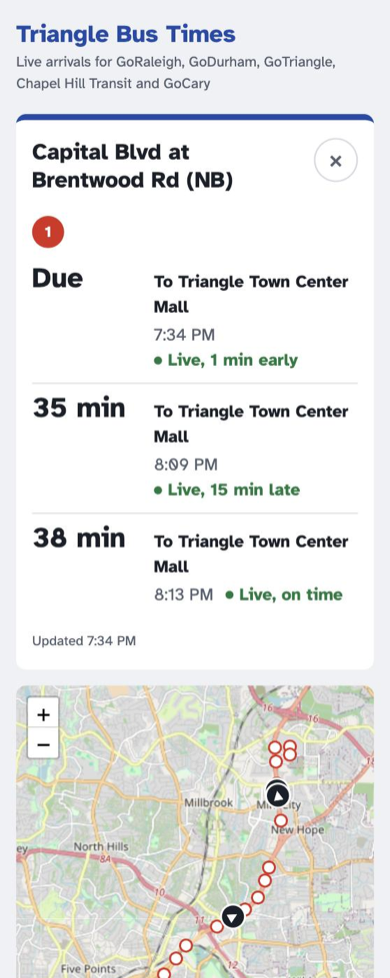
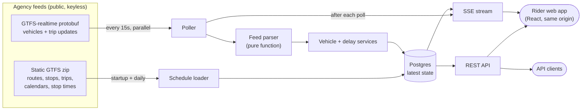
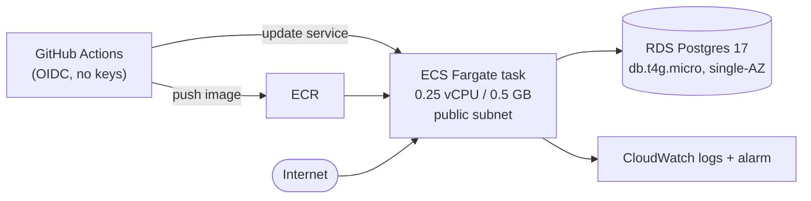

# Transit Tracker

[](https://github.com/ebenezer-morkeh/transit-tracker/actions/workflows/ci.yml)

A Spring Boot service that polls the GTFS-realtime feeds of five Triangle (NC) transit agencies every 15 seconds and serves live **vehicle positions**, **trip delays** and **stop arrivals** through one agency-aware REST API plus a Server-Sent Events stream, with a mobile-first **rider web app** on top.



Agencies: GoRaleigh, GoDurham, GoTriangle, Chapel Hill Transit, GoCary. Each publishes raw protobuf from a different vendor, with overlapping route IDs (GoRaleigh route 1 is not GoDurham route 1). This project normalizes them into one model.

Stack: Java 21, Spring Boot 4.0 (Spring MVC), Spring JDBC (`JdbcClient`), Postgres 17 + Flyway, springdoc OpenAPI, Testcontainers, Docker, GitHub Actions, Terraform (AWS, not applied). Web app: React 18, TypeScript, Vite, react-leaflet with OpenStreetMap tiles, Vitest. Only the latest state is stored, so the database stays small and needs no cleanup job.

Rider web app: **http://localhost:8080/**. Interactive API docs: **http://localhost:8080/swagger-ui.html** (OpenAPI JSON at `/v3/api-docs`).

## Code layout

Packaged by feature; each feature is controller → service → repository, and only services cross feature boundaries (enforced by `ArchitectureTests`; see ADR-0005). Review rules: `CODING_STANDARDS.md`; terms: `GLOSSARY.md`; feed quirks: `docs/feeds.md`.

| Package | What's in it |
|---|---|
| `ingest` | Feed config, HTTP client, GTFS-realtime parser (pure function), the 15s poller. The poller calls `VehicleService` and `DelayService`, never a repository. |
| `vehicles` | `VehiclesController` → `VehicleService` → `VehicleRepository`, plus the SSE `VehicleStream`. |
| `delays` | `DelaysController` → `DelayService` → `TripDelayRepository`, plus `TripDelays`, the pure delay rule. |
| `schedule` | `ScheduleLoader` (daily static GTFS download: routes, stops, trips, calendars, stop times), pure parsers (`GtfsCsv`, `GtfsFiles`, `StopTimesParser`), `ScheduleService` → `ScheduleRepository`. |
| `routes` | `RoutesController` → `RouteService` (natural route-name order) → `ScheduleService`. |
| `arrivals` | `ArrivalsController` → `ArrivalService`, plus `Arrivals`, the pure arrival rule (ADR-0007). Reads the schedule, trip delays and `FeedStatus`. |
| `web/` | The React app. Maven builds it into the jar's static files (`frontend-maven-plugin`, which brings its own Node) and runs its Vitest tests in `verify`. |

Why JDBC and not JPA: the workload is bulk SQL (`INSERT … ON CONFLICT` upserts, "delete what this poll didn't contain", 226k-row batch inserts of the schedule) with no object graph, which JPA handles poorly. Why blocking MVC and not Reactor/WebFlux: 5 feeds every 15s doesn't need a reactive stack; Java 21 virtual threads are the upgrade path if concurrency ever matters.

## Architecture



AWS target layout (written in `infra/`, never applied):



A failing feed is logged and skipped; the other agencies are unaffected. A static schedule that fails to download or parse, or has an empty routes, stops, trips or stop times file (or both calendar files empty), keeps that agency's previous schedule. An agency whose trip updates haven't polled successfully for 2 minutes shows scheduled times, with a notice. Vehicles missing from a successful poll are deleted, so there are no ghost buses.

## Run it

Needs Docker. First start downloads static schedules (~500k rows), so delays appear after about a minute.

```sh
docker compose up --build
curl localhost:8080/actuator/health        # {"groups":["liveness","readiness"],"status":"UP"}
```

Then open http://localhost:8080/ and pick a route, a direction and a stop. Every screen has its own link (for example `/?agency=goraleigh&stop=145`), so a rider can bookmark their stop.

Working on the web app: keep the backend running (Docker or IDE), then run the Vite dev server, which proxies `/api` to `localhost:8080`:

```sh
cd web && npm install && npm run dev       # http://localhost:5173
npm test                                   # Vitest
```

From an IDE: start Postgres only (`docker compose up db`), then run `TransitTrackerApplication`. The defaults in `application.properties` point at `localhost:5432`.

Tests (unit + HTTP end to end against real Postgres via Testcontainers, so Docker must be running):

```sh
./mvnw verify
```

Troubleshooting: GoTriangle's certificate chains to a CA that old JDK 21 GA builds (2023) don't trust, which shows up as a PKIX error for `gotriangle` when running outside Docker. Use a current JDK 21 update, or run via Docker (the image uses a current Temurin JRE).

## API

All responses are JSON. Empty results are `200 []`. Output below is real, trimmed, from a live run on 2026-11-22.

### `GET /api/vehicles?agency={id}&route={id}`

Both parameters optional. `route` requires `agency` (route IDs are only unique per agency), otherwise `400`; a blank `agency` or `route` (`?agency=&route=1`) is also `400`. An unknown agency returns `[]`. Agency IDs: `goraleigh`, `godurham`, `gotriangle`, `chapelhill`, `gocary`.

```sh
curl "localhost:8080/api/vehicles?agency=goraleigh&route=11"
```
```json
[{"agencyId": "goraleigh", "vehicleId": "1605", "tripId": "8269010", "routeId": "11",
  "latitude": 35.783843994140625, "longitude": -78.6683578491211,
  "bearing": 204.0, "speed": 1.34112, "feedTimestamp": "2026-11-23T02:11:31Z"}]
```

`tripId`, `routeId`, `bearing` and `speed` are `null` when the feed omits them (Chapel Hill often has no route). `speed` is m/s, `bearing` degrees. `feedTimestamp` is when the vehicle last reported, so compare it to now to spot stale positions. Without filters, the live run returned 64 vehicles across all agencies.

```sh
curl -i "localhost:8080/api/vehicles?route=11"    # 400 {"title":"Bad Request","status":400,"detail":"route requires agency",...}
curl "localhost:8080/api/vehicles?agency=nope"    # []
```

### `GET /api/agencies/{agency}/routes/{route}/delays`

Trip delays for one route, most delayed first. `delaySeconds` is positive when late, negative when early. `vehicleId` is `null` if the trip has no vehicle assigned yet.

```sh
curl localhost:8080/api/agencies/goraleigh/routes/11/delays
```
```json
[{"agencyId":"goraleigh","tripId":"8269010","routeId":"11","vehicleId":"1605","delaySeconds":524,"feedTimestamp":"2026-11-23T02:11:01Z"},
 {"agencyId":"goraleigh","tripId":"2829010","routeId":"11","vehicleId":"1605","delaySeconds":385,"feedTimestamp":"2026-11-23T02:11:01Z"},
 {"agencyId":"goraleigh","tripId":"4352010","routeId":"11","vehicleId":"1809","delaySeconds":-38,"feedTimestamp":"2026-11-23T02:10:59Z"}]
```

(Trimmed from six trips.) A route with no active trips returns `[]`.

### `GET /api/routes`

Every agency's routes from the static schedule (100 in the live run), by agency then short name in natural order (2 before 10 before 100X). Colours are hex without `#`, `null` when the agency sets none.

```json
[{"agencyId":"goraleigh","routeId":"1","shortName":"1","longName":"Capital Blvd","color":"d92a1c","textColor":"ffffff"},
 {"agencyId":"goraleigh","routeId":"2","shortName":"2","longName":"Falls of Neuse","color":"0086c4","textColor":"ffffff"}]
```

### `GET /api/agencies/{agency}/routes/{route}/stops`

A route's directions, each labelled with its most common headsign, with stops in the order of that direction's longest trip. `directionId` is `null` (one direction) when the agency sets none. Unknown agency or route: `404`.

```json
[{"directionId":0,"headsign":"TRIANGLE TOWN CENTER MALL","stops":[
   {"stopId":"127","name":"GoRaleigh Station","latitude":35.777525,"longitude":-78.637157},
   {"stopId":"128","name":"Wilmington St at Morgan St","latitude":35.779881,"longitude":-78.63806}, ...]},
 {"directionId":1,"headsign":"DOWNTOWN","stops":[...]}]
```

### `GET /api/agencies/{agency}/stops/{stop}/arrivals`

The next 60 minutes of arrivals at a stop, up to 3 per route, routes ordered by their first arrival. An arrival is **live** when its trip has a trip delay under 2 minutes old (expected = scheduled + delay, applied unchanged to every later stop, ADR-0007), else **scheduled**. Trips that haven't started yet come from the static calendar, including yesterday's trips past 24:00:00. Times are ISO-8601 in America/New_York. `liveDataUnavailable` is `true` when the agency's trip updates haven't polled successfully for 2 minutes. Unknown agency or stop: `404`.

```sh
curl localhost:8080/api/agencies/goraleigh/stops/145/arrivals
```
```json
{"agencyId":"goraleigh","stopId":"145","name":"Capital Blvd at Brentwood Rd (NB)","latitude":35.81849,"longitude":-78.59637,
 "liveDataUnavailable":false,
 "routes":[{"routeId":"1","shortName":"1","color":"d92a1c","textColor":"ffffff","arrivals":[
   {"tripId":"5580020","headsign":"TRIANGLE TOWN CENTER MALL","expectedTime":"2026-11-27T19:07:21-05:00",
    "scheduledTime":"2026-11-27T19:06:00-05:00","live":true,"delaySeconds":81},
   {"tripId":"8220020","headsign":"TRIANGLE TOWN CENTER MALL","expectedTime":"2026-11-27T19:16:00-05:00",
    "scheduledTime":"2026-11-27T19:16:00-05:00","live":true,"delaySeconds":0}]}]}
```

Known gaps: cancelled trips still show as scheduled, and stops the schedule leaves untimed get no arrivals.

### `GET /api/vehicles/stream?agency={id}&route={id}`

`text/event-stream`, same optional filters and the same `400` rule. Each event is the filtered vehicle list, pushed right after every poll (about every 15s) in which at least one agency's vehicle feed succeeded.

```sh
curl -N "localhost:8080/api/vehicles/stream?agency=gotriangle"
```
```
data:[{"agencyId":"gotriangle","vehicleId":"07f4a4fb-...","tripId":"81309c30-...","routeId":"3629","latitude":35.8739,"longitude":-78.8374,"bearing":137.65,"speed":0.0,"feedTimestamp":"2026-1...
```

### `GET /actuator/health`

```json
{"groups":["liveness","readiness"],"status":"UP"}
```

## How delays are computed

Per trip, from the next upcoming stop in its trip update: the first stop whose event (arrival if it has a time or delay, else departure) has no time (some feeds list only future stops, with a delay) or a time at or after the feed timestamp. If every listed stop has passed, only the trip-level delay is used:

1. If the feed sends `delay`, use it.
2. Otherwise `delay = predicted time - scheduled time`. The scheduled time comes from the static GTFS `stop_times.txt` (matched by agency + trip ID + stop sequence, else stop ID): the service date at "noon minus 12 hours" local time (the GTFS definition, correct on DST change days) plus the GTFS time, which can exceed 24:00:00.
3. Else fall back to a trip-level delay if present; otherwise the trip is skipped.

Why the static schedule is needed: most feeds don't send `delay`. Measured on 2026-11-22 (stop time updates with `delay` set / total):

| Agency | Has `delay` |
|---|---|
| GoRaleigh | 0 / 2074 |
| Chapel Hill | 0 / 30 |
| GoCary | 42 / 183 |
| GoTriangle | 77 / 529 |
| GoDurham | 1549 / 1554 |

Static schedules are downloaded at startup and daily; a failed download keeps the previous schedule.

## Infrastructure: written, not applied, $0

`infra/` contains Terraform (us-east-1) for ECR, an ECS Fargate service, RDS Postgres, CloudWatch logs and an alarm, and a GitHub OIDC deploy role. `.github/workflows/deploy.yml` deploys on merge to `main` and skips itself until the `AWS_ROLE_ARN` repository variable is set. Region and resource names come from repository variables (`AWS_REGION`, `ECR_REPOSITORY`, `ECS_CLUSTER`, `ECS_SERVICE`, `TASK_FAMILY`, `CONTAINER_NAME`) with the Terraform defaults as fallbacks; see `infra/README.md`.

**Nothing has ever been applied.** CI only runs `terraform fmt -check` and `terraform validate`, which need no AWS account, so the project costs $0. The consequence: the IAM policies and the deploy workflow are validated syntactically but unverified against real AWS.

Estimated cost if applied: about **$15-25/month** (Fargate 0.25 vCPU / 0.5 GB ~$9, db.t4g.micro + 20 GB ~$14 less under free tier, public IPv4 ~$3.60, plus small CloudWatch, ECR and Secrets Manager charges).

Apply and tear down (details in [infra/README.md](infra/README.md)):

```sh
cd infra
terraform init
terraform apply -var github_repo=ebenezer-morkeh/transit-tracker
terraform destroy -var github_repo=ebenezer-morkeh/transit-tracker
```

It is designed for minimum cost, not production. For production, add:

- an Application Load Balancer with HTTPS in front of two or more tasks (today the task's public IP changes on every deploy)
- private subnets plus a NAT Gateway (or VPC endpoints) so the tasks aren't publicly addressable
- Multi-AZ RDS with backups and deletion protection
- remote Terraform state (S3 + locking; the backend block is commented out in `versions.tf`)

## What's next

- Public hosting for the rider web app (it runs locally only; see the cost notes above), with a tile provider whose terms allow it
- Cancelled trips from trip updates, so they drop out of arrivals
- "Stops near me" from the rider's location
- Route lines on the map from `shapes.txt`
- Delay history for analytics
- SNS alerts when a route's delays cross a threshold
- Kafka or SQS between ingestion and storage
- Nationwide coverage via the Mobility Database

## Attribution

Feed data is published by GoRaleigh, GoDurham, GoTriangle, Chapel Hill Transit and GoCary under Creative Commons Attribution, as listed on the [GoDurham developer resources page](https://godurhamtransit.org/developer-resources). Thanks to each agency for publishing open data.

Map tiles and data © [OpenStreetMap](https://www.openstreetmap.org/copyright) contributors.

Code is MIT licensed, see [LICENSE](LICENSE).
